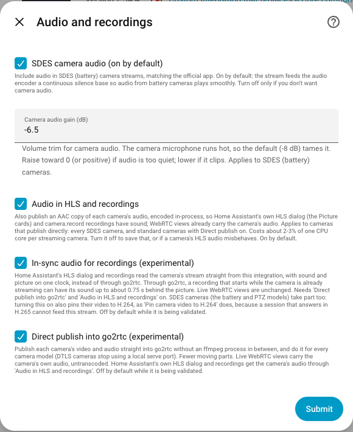
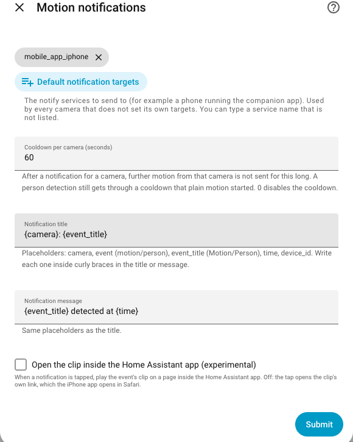

# AiDot Cameras for Home Assistant

[](https://github.com/hacs/integration)
[](https://github.com/cbrightly/hass-aidot-cameras/releases)
[](LICENSE)

A Home Assistant custom integration for **AiDot / Leedarson** Wi-Fi lights **and
cameras**: live WebRTC video, two-way audio, PTZ, motion events and
notifications, cloud and SD-card recordings in the media browser, camera
controls, and the usual light controls. It is a camera-capable fork of the
upstream lights-only
[AiDot-Development-Team/hass-AiDot](https://github.com/AiDot-Development-Team/hass-AiDot).

The integration is the Home Assistant front end; all device communication lives
in the [`python-aidot-cameras`](https://github.com/cbrightly/python-aidot-cameras)
library, which it installs automatically (1.0.0rc71 or later).

<!--
Hero screenshot slot -- add a PNG at docs/hero.png in this repo, then replace this
whole comment with the line below (it publishes with the repo and renders here):
<p align="center"></p>
-->

## Installation (HACS)

> **This replaces the core AiDot integration.** Home Assistant ships a built-in,
> lights-only `aidot` integration. This one claims the same `aidot` domain to add
> cameras, so it overrides the core one, which is why it installs as a HACS
> **custom repository** rather than from the HACS default store.

1. In HACS -> (menu) -> **Custom repositories**, add
   `https://github.com/cbrightly/hass-aidot-cameras` with category **Integration**.
2. Search for **AiDot**, **Download** it, then restart Home Assistant.
3. **Settings -> Devices & Services -> Add Integration -> AiDot Cameras**, and
   sign in with your AiDot account (email address, password, country).

Camera streaming needs **ffmpeg** and **go2rtc**. Both ship with Home Assistant
OS and Container, but the battery and PTZ cameras need a go2rtc they can publish
into, which Home Assistant's bundled one is not: see
[go2rtc: which one the cameras use](#go2rtc-which-one-the-cameras-use).

Sign in with the account that **owns** the devices if you want local (LAN)
control: see [Local control and which account you sign in
as](#local-control-and-which-account-you-sign-in-as). Full steps and
prerequisites:
**[Installation](https://github.com/cbrightly/hass-aidot-cameras/wiki/Installation)**.

## Configuration

Everything is under **Settings -> Devices & Services -> AiDot Cameras ->
Configure**, on four pages. The defaults suit most installs.

**Live view and connection**

| Option | Default | What it does |
| --- | --- | --- |
| Camera stream port base | 18600 | First local port for standard (DTLS) cameras that do not publish into go2rtc; each camera uses a port in base..base+399. Change only on a conflict. |
| Connection mode | Automatic | **Automatic** offers every path, prefers the LAN and keeps the cloud relay as a fallback. **LAN only** skips the relay for a faster start, but a camera that cannot reach Home Assistant directly will not connect (battery cameras keep the relay regardless). |
| SDES fast connect | on | Skips one handshake wait so SDES cameras start about 4.5 s sooner; the PTZ is excluded automatically. Turn off if a live view drops to a snapshot on a specific camera. |
| Mains camera warm-hold (seconds) | 0 | How long a mains camera's session stays open after the last viewer. `0` keeps it open (instant views); a positive window lets unwatched cameras go idle and reconnect on view in about 2.4-3.3 s. Battery cameras ignore it. |
| Local camera control | off | Sends camera settings over the LAN instead of the cloud for eligible mains cameras, with cloud fallback. Does not affect video. |
| Warm camera sessions at startup | on | Opens each mains camera's session in the background after a restart, so the first view is warm. |
| Pre-connect on motion | **off** | Opens a mains camera's session when it reports motion, so a live view opened soon after starts warm. Off because a motion notification opens the cloud clip, not a live view, so these sessions mostly streamed to nobody. Mains cameras only. Takes effect without a reload. |

**Audio and recordings**

<p align="center"></p>

| Option | Default | What it does |
| --- | --- | --- |
| Camera audio gain (dB) | 0 | Volume trim after the library's level normalizer; `0` serves battery and PTZ cameras at the same loudness as an M3 Pro. Installs that saved the old -8 dB default keep it. |
| Publishing, and audio in HLS and recordings | Direct publish, in sync | How each camera reaches go2rtc and how Home Assistant's own HLS dialog (the Picture cards) and `camera.record` get its sound. **Direct publish, in sync** (the default) publishes each camera into go2rtc from the integration's own process, with no ffmpeg process per camera, adds an AAC track for HLS and recordings, and has them read mains cameras' streams straight from this integration with sound and picture on one clock. **...through go2rtc** keeps the AAC track but reads go2rtc's stream; **...no audio in HLS and recordings** drops the AAC track (it costs about 2-3% of one CPU core per streaming camera). The two **ffmpeg** modes go back to an ffmpeg process per standard camera; SDES cameras still publish. See [Audio](#audio) and [go2rtc](#go2rtc-which-one-the-cameras-use). |

**Motion notifications - targets and wording** and **Motion notifications - per
camera**

<p align="center"></p>

| Option | Default | What it does |
| --- | --- | --- |
| Default notification targets | none | The notify services to send to (for example a phone with the companion app). |
| Cooldown per camera (seconds) | 60 | Further motion from a camera is not sent for this long after a notification; a person detection still gets through a cooldown plain motion started. `0` disables it. |
| Notification title / message | `{camera}: {event_title}` / `{event_title} detected at {time}` | Placeholders: `camera`, `event`, `event_title`, `time`, `device_id`. |
| Open the clip inside the Home Assistant app (experimental) | off | A tapped notification plays the clip on a page in the app. Off, the tap opens the clip's own link (on an iPhone, in Safari). |
| Send a notification for (per camera) | Off | Off, All (motion and person), or Person only. |
| Targets for this camera | empty | Overrides the default targets for one camera. |

More detail: **[Configuration options](https://github.com/cbrightly/hass-aidot-cameras/wiki/Configuration-options)**.

### go2rtc: which one the cameras use

In the direct-publish modes of **Publishing, and audio in HLS and recordings**
(the default), each camera's video and audio go straight into a go2rtc, H.264 sessions only (an H.265 session keeps
the ffmpeg path). Where they go depends on what is installed:

- **A go2rtc answering on port 1984** (the WebRTC Camera integration or the
  go2rtc add-on) is published into.
- **`AIDOT_GO2RTC_API`** names any other go2rtc to publish into (see
  [Environment overrides](#environment-overrides)).
- **Home Assistant's bundled go2rtc is never published into**: its client cannot
  read a published stream, and every WebRTC offer would fail. Standard (DTLS)
  cameras keep a local serve that it pulls; **SDES cameras (the battery and PTZ
  models) get no live view** and open no session, and **Settings -> Repairs**
  says so.

So on Home Assistant OS or Container with only the bundled go2rtc, install the
**WebRTC Camera** integration or the **go2rtc** add-on (answering on
`127.0.0.1:1984`) and restart. On Home Assistant Core, set `AIDOT_GO2RTC_API` to
a go2rtc you run.

> **Do not point Home Assistant's `go2rtc:` `url:` at the go2rtc the cameras
> publish into** (the go2rtc add-on, Frigate's, or a standalone 1.9.13 or newer).
> Home Assistant cannot read a published stream and reads the whole stream list
> on every WebRTC offer, so every camera's live view would fail. The integration
> detects this and does not publish there: standard cameras are pulled instead
> (without the in-sync HLS audio and the AAC track), SDES cameras are not
> streamed, and **Settings -> Repairs** says so. The WebRTC Camera integration's
> own go2rtc (1.9.9) is older than Home Assistant accepts, so pointing `url:` at
> it makes Home Assistant fall back to HLS for every camera instead.
>
> **Fix on OS or Container:** remove the `url:` line from the `go2rtc:` section
> of `configuration.yaml` and restart; Home Assistant then uses its built-in
> go2rtc and pulls each AiDot camera from the other server. **On Core**, where
> `url:` is required, run a second go2rtc for the cameras and point
> `AIDOT_GO2RTC_API` at it.

## A fast live view

1. **Use a WebRTC dashboard card**, not the default Picture / Picture Glance
   card, which plays through Home Assistant's HLS dialog and its ~20 s buffer so
   every view starts seconds late. See
   [Dashboard cards](https://github.com/cbrightly/hass-aidot-cameras/wiki/Dashboard-cards).
2. **An idle camera takes a moment on its first view** while the handshake
   runs; later views are quick. A slow *first* frame is expected; a slow
   *every* frame almost always means the wrong card.

Time for the camera to start sending video on a **cold** open (the middle 80%
of about 300 cold opens on a live install):

| Camera | Cold open |
| --- | --- |
| mains, standard (DTLS) models | ~2.4 - 3.3 s |
| mains, SDES models (PTZ / spotlight) | ~2.3 - 2.8 s |
| battery (L2) models | ~3 - 6 s, mostly the camera waking |

A **warm** view starts immediately. Mains cameras are held warm by default. If
one keeps reconnecting while idle, it is a model that stops sending when
unwatched: give it a positive **Mains camera warm-hold** window instead.

**Battery cameras are never held warm** (a held session drains them), so every
view pays the wake, which varies; the view waits it out and gives up after about
a minute if the camera is unreachable. Nothing wakes a battery camera just to
poll it: thumbnails come from the cloud, the periodic sensor refresh skips them,
and they are excluded from the startup warm-up and from pre-connect on motion.
A battery camera streams only while someone is viewing it and stops within
about half a minute of the last viewer leaving (plus Home Assistant's own 30 s
for the HLS dialog).

## Features

- **Lights**: on/off, brightness, colour (RGBW) and colour temperature.
- **Live video**: WebRTC (via go2rtc) and snapshots, LAN-direct when the camera
  is on the same network.
- **Motion events**: a **Motion** `event` entity (event types motion and
  person) for automations, and an **Occupancy** binary sensor.
- **Motion notifications**: per camera, motion or person only, to the notify
  services you choose, with the camera's picture of what triggered it; a tap
  opens the clip. This path is independent of the AiDot app's own
  notifications: Home Assistant polls the camera's cloud event list, the app
  has its own push channel, and neither turns the other on or off.
- **Recordings in the media browser**, grouped by day:
  - **Cloud clips** (with a cloud plan).
  - **SD card recordings** on the PTZ (A001064), L2 (A001513) and M3 Pro
    (A000088), listed and playable. The first play fetches the clip off the
    card into a cache (about the clip's own length, capped at 2 minutes) and
    stops the live view meanwhile ("Playing a recording from the SD card");
    replays are instant and card clips stay cached for 7 days. A fetch can be
    stopped from the clip page's **Stop fetching** button or with
    `aidot.stop_sd_playback`. A battery camera below 20% charge is not woken
    for one.
  - Listing the card needs a camera session, so browsing never opens one. The
    list is refreshed when a pre-warm opens a session (the startup warm-up, the
    re-warm after a card playback, and pre-connect on motion when that is on)
    and by the camera's **Refresh on-device recordings** button. A camera held
    warm opens no new pre-warm, so press the button to see recordings made
    since startup. A camera never listed says "Not listed yet".
  - Details: [On-device recordings](https://github.com/cbrightly/hass-aidot-cameras/wiki/On-device-recordings).
- **Wake and sleep**: `aidot.wake` wakes a battery camera ahead of a view or a
  `camera.record` (its wake can take 40 s or more, which a 60 s recording
  otherwise spends waiting; call it about 45 s before), and `aidot.sleep`
  sends it back to sleep afterwards instead of 25 s later. The wake keeps the
  camera awake for `hold` seconds (default 60) with the keep-alive renewals
  the app sends until its live view opens. Both are refused on a mains
  camera, and sleep while the camera is streaming.
- **Card recordings in the media browser** with thumbnails for the newest 40,
  fetched from the camera on each listing taken over a live session, and
  `aidot.delete_sd_recording` to delete one (by its media-browser key or its
  start time; the camera must be streaming; cannot be undone).
- **Two-way audio**: `aidot.talk` plays a media clip or URL through the camera
  speaker; no live view needed.
- **PTZ**: **Move left / right / up / down**, **Zoom in / out** and **Stop**
  buttons, limited to the directions the camera advertises (the PTZ A001064
  advertises pan only), plus the `aidot.ptz` service. The camera must be
  streaming.
- **Detection types**: **Person**, **Vehicle**, **Package** and **Pet detection**
  switches.
- **Sound detection**: **Sound detection**, **All sound detection**, and one
  switch per detector the camera reports (**Glass break**, **Smoke alarm (T3 /
  T4)**, **Baby cry**, **Dog bark detection**). Mains cameras only
  ([why](https://github.com/cbrightly/hass-aidot-cameras/wiki/Known-limitations)).
- **Siren**: the **Siren** entity sounds it now; **Auto alarm**, **...on
  motion**, **...on person** and **...on glass break** set when the camera
  sounds it itself (each trigger only where the camera reports it).
- **Floodlight**: the **Floodlight** light, **Light when someone appears**,
  **Light brightness** and **Light behavior** (constant or flash), each only
  where it works.
- **Linger duration** (20-50 s): how long a person must stay before the camera
  triggers, to cut false triggers. The app files it under person detection and
  greys it out unless that is on. Earlier releases called it "Light stays on
  for"; it is not the light's on-time.
- **Controls**: **Motion detection**, **Status LED**, **Microphone (audio
  privacy)**, **Auto-tracking**, **Night vision**, **Motion sensitivity**,
  **Speaker volume**, **Watermark** (the timestamp overlay), **WDR**, **Voice
  prompts**, a per-camera **Camera audio (in HA stream)** switch for SDES
  cameras, and a **Reboot** button. The camera's firmware version shows on its
  device page. Each camera also takes `camera.turn_off` / `camera.turn_on`,
  the app's live-screen switch: off, it stops streaming and recording and the
  entity reads "off" until turned on.
- **Battery** on battery cameras.
- **Diagnostics** (disabled by default): **SD card**, **SD card
  total / used**, **Wi-Fi signal**, **Wi-Fi network**. The SD figures carry no
  unit because the camera does not say what they are. **Download diagnostics**
  also lists any device the integration does not claim (a hub, a plug) under
  `unclaimed`, the library versions in use, and each camera's firmware version
  and the properties its model's profile declares.

Controls appear only where the value can be read back from the device, because
this firmware acknowledges writes it then ignores. Status LED, Voice prompts,
WDR, Watermark, Microphone, Light when someone appears and the Floodlight also
appear only on a model whose cloud profile declares them, as the app's do (so
the L2 has no WDR and the M3 Pro no Voice prompts); a camera whose profile
cannot be read keeps them all.

## Audio

- **Live WebRTC views** carry the camera's own G.711 audio, untranscoded.
- **Home Assistant's HLS dialog** (opened by the Picture and Picture Glance
  cards) **and `camera.record`** accept only AAC. In every mode of
  **Publishing, and audio in HLS and recordings** except the "no audio" ones
  (the default included), the library publishes its own AAC track, timed from
  the camera's audio clock and lined up with the picture from the first
  seconds, for cameras that publish directly (every SDES camera, and standard
  cameras in the direct-publish modes). Without it, that dialog is silent but
  at the right speed, as it is for a camera whose audio is mu-law.
- **In sync** (the default mode) has the HLS dialog and recordings read the
  stream straight from this integration. Through go2rtc, a
  recording that joins a running stream can have its sound up to about 0.75 s
  behind the picture; in sync, measured offsets were within 0.1 s. The stream
  is served only on the Home Assistant host, with a fresh secret each start
  that Home Assistant masks in its logs. Battery cameras are not in sync
  (they read go2rtc's stream, as their lossy link rarely gives the clean
  keyframe the in-sync stream needs).
- **Two-way audio** (talking to the camera) works regardless of the card.

## Your cameras are reachable through go2rtc

The cameras themselves do not speak RTSP. Each is registered as a go2rtc stream
named `aidot_` plus the first twelve characters of its device id (the exact
list is in go2rtc's `/api/streams`):

```
rtsp://<the host running go2rtc>:8554/aidot_<id12>
```

Point Frigate, an NVR or VLC at it and you get the camera without a second cloud
connection or a second session on the camera: everything pulling from go2rtc
shares the integration's one session. A stream carries media only while the
camera has a live session: around the clock for a mains camera with the default
warm-hold, otherwise while someone is watching (and for the warm-hold window
after).

**By default go2rtc serves it to anyone who can reach it, with no password.**
go2rtc can require credentials; in `go2rtc.yaml`:

```yaml
rtsp:
  listen: ":8554"
  username: "someone"
  password: "something-long"
api:
  listen: ":1984"
  username: "someone"
  password: "something-long"
```

The URL is then `rtsp://someone:something-long@<host>:8554/aidot_<id12>`.
Verified against go2rtc 1.9.14 (the version Home Assistant ships): no or wrong
credentials from another machine get `401`. **go2rtc exempts loopback**, so
test from a different machine. Alternatively bind go2rtc to loopback or
firewall the port. The integration's own local serve is loopback only, and the
library warns if decrypted media is ever served on another address.

## Troubleshooting

**Always update first**: many past reports were bugs already fixed; the
[CHANGELOG](CHANGELOG.md) says which. The full list is on the
**[Troubleshooting](https://github.com/cbrightly/hass-aidot-cameras/wiki/Troubleshooting)**
wiki page.

- **A battery camera's first view after a long sleep shows nothing, then works
  on the next try.** Expected: a deeply asleep camera sometimes acknowledges and
  never starts the stream. The attempt is abandoned and retried (after about
  20 s if the camera has gone quiet). Repeated failures are worth a bug report.
- **SDES cameras (battery, PTZ) have no live view; standard cameras work.**
  There is no go2rtc they can publish into; see
  [go2rtc: which one the cameras use](#go2rtc-which-one-the-cameras-use).
- **Every camera's live view fails, and the log shows `Field "url"` /
  `Producer` from `go2rtc_client`, or a repair says Home Assistant's go2rtc
  reads the server the cameras publish into.** Your `go2rtc:` `url:` points at
  that server; see the note under
  [go2rtc](#go2rtc-which-one-the-cameras-use).
- **Live view buffers like HLS.** Use a WebRTC card, and check a go2rtc is
  reachable (above). Without one a standard camera falls back to HLS.
- **Every live view dropped to HLS at once, and the log shows `go2rtc: add
  stream 'aidot_...' failed http=400` for every camera.** go2rtc's
  `go2rtc.yaml` lists a stream twice (`mapping key ... already defined`), which
  makes go2rtc 1.9.9 reject every registration; a repair issue names it. Stop
  go2rtc, delete the second copy of the duplicated `aidot_...:` block, start
  go2rtc. This integration never writes two registrations at once, which is
  what tears the file.
- **Live view plays in slow motion.** Update to 2.30.4 or later. An AAC copy of
  the camera audio with stretched timestamps made players crawl; do not add an
  `ffmpeg:...#audio=aac` source to the streams yourself
  ([why](https://github.com/cbrightly/python-aidot-cameras/blob/main/docs/CAMERAS.md#an-aac-transcoding-source-makes-every-player-crawl)).
- **A camera connects but the picture stays blank.** Its media is usually not
  reaching Home Assistant, most often because of network isolation (a separate
  VLAN, or AP/client isolation). If it shares the Home Assistant LAN, set
  **Connection mode** to **LAN only**. See
  [Troubleshooting](https://github.com/cbrightly/hass-aidot-cameras/wiki/Troubleshooting#camera-connects-but-the-picture-stays-blank-no-video).
- **The PTZ's HLS view or recording is blank in the in-sync mode, while the
  live view works.** The camera answered in H.265 despite the H.264 pin (about
  one open in seven); such a session is re-opened up to twice (log: `sent video
  payload type 97 against an offer pinned to 96 ... re-opening`). The next
  session is normally fine.
- **The SD card list is old or says "Not listed yet".** Press the camera's
  **Refresh on-device recordings** button.
- **A light cannot be controlled locally.** If its address is outside every
  network Home Assistant is on (another subnet or VLAN), local login cannot
  reach it; after enough failures **Settings -> Repairs** names the light and
  address. It clears once a local login succeeds or the light is removed. Also
  check [which account you sign in as](#local-control-and-which-account-you-sign-in-as).

### Reading the health line

Every live session logs one INFO line a minute under
`aidot_cameras.camera.health`:

```
camera <id>: health 20s: packets=1686 (84.1/s) lost=0 (0.0%) stall=0.0s path=direct viewers=present
```

- **The link is lossy**: `lost` climbs (DTLS cameras; SDES cameras recover loss
  by retransmission and report `bytes` instead).
- **The picture froze**: `stall` climbs while `lost` stays 0; the camera stopped
  sending. A DTLS session with no video for 30 s is re-opened on its own; an
  SDES camera gets a nudge first.
- **Nobody was watching**: `viewers=absent` past the idle window, after which
  the session is released. `unknown` means the go2rtc could not be asked.
- `path=relay` means the media rides the vendor's relay, normal for a camera on
  another subnet. DTLS cameras' lines also carry `frames`, `resent`,
  `keyframes` and `max_keyframe_gap`. The interval is `AIDOT_HEALTH_LINE_S`
  (`0` turns it off). Field details are in the
  [library README](https://github.com/cbrightly/python-aidot-cameras#reading-the-health-line).

### Environment overrides

Rarely needed, and off the supported path:

| Variable | Effect |
| --- | --- |
| `AIDOT_GO2RTC_API` | The API URL of a go2rtc to publish into (e.g. `http://<host>:1984`), instead of the one on port 1984. Home Assistant's bundled go2rtc is never published into. |
| `AIDOT_GO2RTC_RTSP_PORT` | The RTSP port of that server. Default 8554; a malformed value logs a warning and falls back to 8554. |
| `AIDOT_VIDEO_DECODER` | Force a decoder by name, or `hwaccel:<method>` (e.g. `hwaccel:videotoolbox`). Otherwise each candidate must decode a sample on your machine, and the fastest measured wins. |
| `AIDOT_DISABLE_HWACCEL=1` | Keep to software decoding. |
| `AIDOT_SERVE_RELAY=1` | Re-enable the library's serve relay. Testing only. |
| `AIDOT_SERVE_PORT_BASE` | The first local serve port, for an entry that has not saved the option of the same name. The option wins. |

The publish mode and the H.264 pin (always on) are not environment variables: each entry hands its
own to the library client it creates, so two accounts keep their own settings
and nothing is written to Home Assistant's environment. The library's
variables for them (`AIDOT_DIRECT_PUBLISH`, `AIDOT_PUBLISH_AAC`,
`AIDOT_HLS_DIRECT_TS`, `AIDOT_SDES_VIDEO_PT`) have no effect here; use the
option.

## Supported devices

Confirmed on AiDot / Leedarson Wi-Fi bulbs and the **M3 Pro (A000088)**, **L2
battery (A001513)** and **PTZ (A001064)** cameras; other models should work.
A BLE hub on the account (a B1 Plus, say) gets no device or entities, and the
lights behind it are not reachable through this integration. Full entity list:
**[Supported devices](https://github.com/cbrightly/hass-aidot-cameras/wiki/Supported-devices)**.
Camera models, transports and test status are in one table in the library's
[CAMERAS.md](https://github.com/cbrightly/python-aidot-cameras/blob/main/docs/CAMERAS.md#supported-cameras).

## Local control and which account you sign in as

Devices accept local (LAN) control **only from the account that owns them**.
Signed in as a member of a shared home, everything still works through the
cloud, but local control never engages: the cloud hands a shared member a
complete device list, credentials included, and the device then refuses the
login. **So if "Local camera control" is on and nothing happens, check the
account first.** A secondary login (made so the integration does not contend
with the phone app over a rotating token) controls everything through the cloud
and never logs in locally. Live video does not use this path. Per-model refusal
codes: [Known limitations](https://github.com/cbrightly/hass-aidot-cameras/wiki/Known-limitations).

## Documentation

The **[Wiki](https://github.com/cbrightly/hass-aidot-cameras/wiki)** is the full reference:

- **Getting started**:
  [Installation](https://github.com/cbrightly/hass-aidot-cameras/wiki/Installation) |
  [Configuration options](https://github.com/cbrightly/hass-aidot-cameras/wiki/Configuration-options) |
  [Supported devices](https://github.com/cbrightly/hass-aidot-cameras/wiki/Supported-devices)
- **Cameras**:
  [Overview](https://github.com/cbrightly/hass-aidot-cameras/wiki/Cameras) |
  [Dashboard cards](https://github.com/cbrightly/hass-aidot-cameras/wiki/Dashboard-cards) |
  [PTZ control](https://github.com/cbrightly/hass-aidot-cameras/wiki/PTZ-control) |
  [Two-way audio](https://github.com/cbrightly/hass-aidot-cameras/wiki/Two-way-audio) |
  [Cloud recordings](https://github.com/cbrightly/hass-aidot-cameras/wiki/Cloud-recordings) |
  [On-device recordings](https://github.com/cbrightly/hass-aidot-cameras/wiki/On-device-recordings)
- **Using it**:
  [Automation examples](https://github.com/cbrightly/hass-aidot-cameras/wiki/Automation-examples) |
  [Services reference](https://github.com/cbrightly/hass-aidot-cameras/wiki/Services)
- **Help**:
  [Troubleshooting](https://github.com/cbrightly/hass-aidot-cameras/wiki/Troubleshooting) |
  [Known limitations](https://github.com/cbrightly/hass-aidot-cameras/wiki/Known-limitations) |
  [FAQ](https://github.com/cbrightly/hass-aidot-cameras/wiki/FAQ)

## License

MIT -- see [LICENSE](LICENSE). This integration is not affiliated with or endorsed
by AiDot or Leedarson; it is community-maintained and provided as-is.
